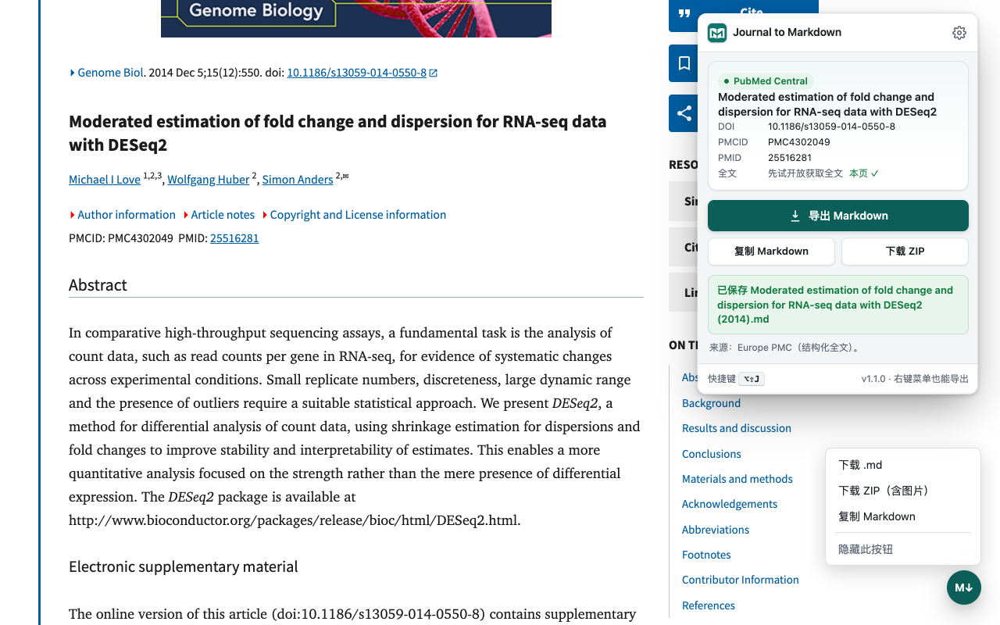
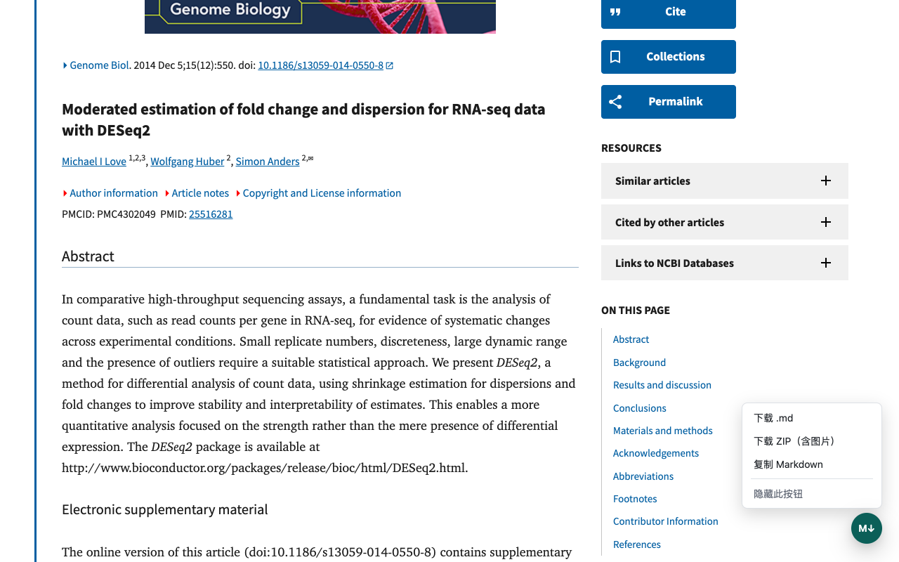
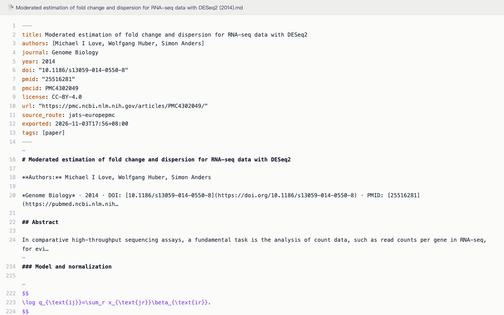
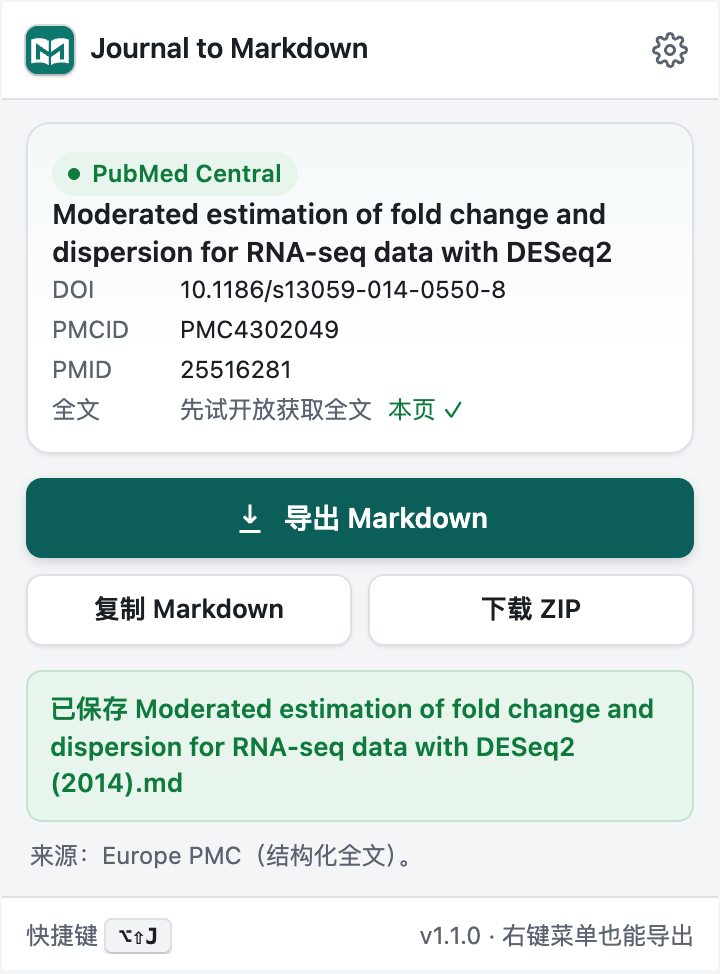
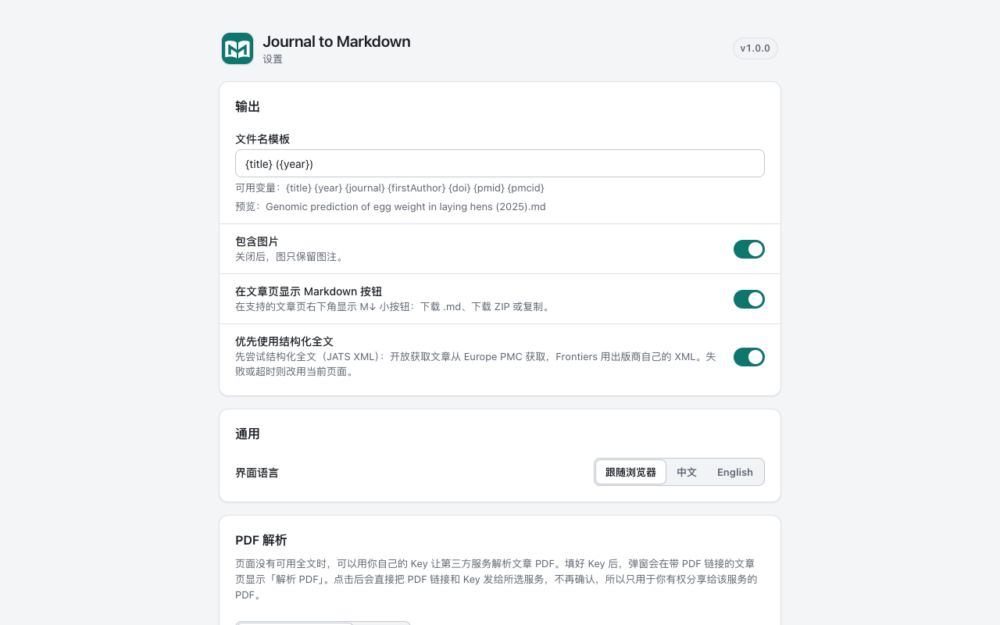

<div align="center">


# Journal to Markdown

**Save the journal article you are reading as clean Markdown in one click.**

[](https://github.com/Tendo33/journal-md/releases)
[](./LICENSE)
[](./src/manifest.json)

[Install](#install) · [中文说明](./README.md) · [Permissions](./docs/permissions.md) · [Privacy](./PRIVACY.md) · [Changelog](./CHANGELOG.md)

<picture>
  <source media="(prefers-color-scheme: dark)" srcset="docs/screenshots/hero-dark.png">
  
</picture>

</div>

> **The "to Markdown" series**: [arXiv to Markdown](https://github.com/Tendo33/arxiv-md) · [Zhihu to Markdown](https://github.com/Tendo33/zhihu-md) · **Journal to Markdown**. Three extensions with the same interface and export habits, for arXiv preprints, Zhihu and journal full text.

Export a full-text article page from PubMed Central, Nature, Frontiers and others to Markdown with title, authors, abstract, sections, math (TeX), tables, figure captions and footnoted references — ready for Obsidian, Zotero or an AI assistant.

## Features

- **Four ways in**: the **M↓ button** at the bottom right of article pages (menu: Download .md, Download ZIP, Copy), the toolbar popup, the right-click menu, and `Alt+Shift+J` (export). The button works with the keyboard and screen readers, follows dark mode, and can be hidden from its menu or in Settings.
- **Output**: YAML front matter (title, authors, journal, year, doi, pmid, pmcid, license, url, `source_route`, exported); math as `$…$` / `$$…$$`; simple tables as GFM, tables with merged cells kept as HTML; in-text citations as `[^n]` footnotes with DOI links; data availability, funding, competing interests and acknowledgements as their own sections; supplementary files listed with links.
- **Download ZIP**: `article.md` + `images/`, with image links rewritten to the local files. Springer / BMC / Nature and PLOS images sit on servers that block cross-site downloads (`media.springernature.com`, PLOS's image storage), so they are downloaded in the background. If an image still fails, the ZIP is created anyway, that image keeps its web link, and a message says so.
- **Quick PDF parse**: when the article has a PDF, the popup offers "Quick PDF parse": the PDF is downloaded on the page (with your sign-in) and its text layer is converted to Markdown with pdf.js (columns, headings, hyphenation, captions, references) in seconds, **sent to no service, no key needed**. Formulas, tables and figures may be incomplete; scanned PDFs have no text layer, so use PDF parsing below.
- **PDF parsing (optional)**: when a page has no usable full text, the article PDF can be parsed by **PaddleOCR** (default) or **MinerU** with your own key; the result downloads as a ZIP. Once the selected service has a key in Settings, the popup shows "Parse PDF with …"; clicking it sends the PDF straight away, without asking again. With PaddleOCR the extension first downloads the PDF in your browser (your network, your sign-in) and uploads the file, so subscription articles you can open can be parsed too; if that download fails it sends the link instead. MinerU still gets the link only. Only parse PDFs you are allowed to share with a third party. Tokens stay in this browser (`chrome.storage.local`).
- **English and Chinese interface**, following the browser language or set in Settings.

| Page button | Exported Markdown |
| --- | --- |
|  |  |

## Supported sites

| Site | Structured full text tried first | Fallback |
| --- | --- | --- |
| PubMed Central (pmc.ncbi.nlm.nih.gov) | Europe PMC JATS (by PMCID) | the page |
| Europe PMC (europepmc.org) | Europe PMC JATS (by PMCID) | the page |
| PubMed (pubmed.ncbi.nlm.nih.gov) | full text when the article has an open-access PMCID | citation + abstract + MeSH, marked "Abstract only" |
| Springer Link / BMC / SpringerOpen | Europe PMC JATS (looked up by DOI, open access only) | the page |
| Nature / Scientific Reports | Europe PMC JATS (by DOI) | the page |
| Frontiers | Frontiers' own XML | Europe PMC JATS → the page |
| MDPI | Europe PMC JATS (by DOI) | the page |
| PLOS | Europe PMC JATS (by DOI) | the page |
| eLife | Europe PMC JATS (by DOI) | the page |
| Wiley Online Library (including society journals on `*.onlinelibrary.wiley.com`) | Europe PMC JATS (by DOI, when open access) | the page (full text when you have access) |
| Cell Press (cell.com) | Europe PMC JATS (by DOI, when open access) | the page |
| Oxford Academic (academic.oup.com) | Europe PMC JATS (by DOI, when open access) | the page |
| Taylor & Francis Online | Europe PMC JATS (by DOI, when open access) | the page (table contents live in a pop-up; only table titles are exported) |
| ScienceDirect | Elsevier full-text API (with your Elsevier API key, on a subscribed institutional network) | citation + abstract (the page has a bot check, so the body is not read from it), then free versions |

It converts only pages you can already read: no paywall bypassing, no bulk crawling. Subscription articles you have access to can be exported from the page.

When a page only shows the abstract (usually because you don't have access), the extension asks **Unpaywall** and **bioRxiv / medRxiv** by DOI for a legal free version. Author manuscripts in PMC and bioRxiv / medRxiv preprints have structured full text and are exported directly (citation from the journal page; the file says which version the text comes from). Other free versions (arXiv preprints, repository PDFs) are listed in the popup; a PDF can be parsed with one click, and arXiv preprints are best exported with [arXiv to Markdown](https://github.com/Tendo33/arxiv-md). If nothing is found, no file is created; "Export abstract anyway" exports the abstract (marked `abstract_only`). Shadow libraries such as Sci-Hub or LibGen are never used.

## Install

- **Chrome / Edge**: download `journal-md-v<version>-chrome.zip` from [Releases](https://github.com/Tendo33/journal-md/releases), unzip it, enable developer mode in `chrome://extensions` (`edge://extensions`) and choose "Load unpacked".
- **Firefox** (140+): download `journal-md-v<version>-firefox.zip` from the same page; this section will point to AMO once the signed add-on is listed.
- Chrome Web Store and Edge Add-ons listings are in preparation.

## Usage

1. Open an article on a supported site, e.g. <https://pmc.ncbi.nlm.nih.gov/articles/PMC7095418/>.
2. Click the **M↓** button at the bottom right and choose Download .md, or click the toolbar icon and choose Export Markdown.
3. Choose Download ZIP to keep the images, or Copy Markdown to paste it somewhere.

| Entry point | What it does |
| --- | --- |
| Page button | M↓ at the bottom right of article pages: Download .md, Download ZIP, Copy; hide it from its menu or in Settings |
| Toolbar popup | Platform, title, DOI / PMCID / PMID and full-text source of the current article; Export, Copy, Download ZIP; Parse PDF once a key is set |
| Shortcut | Export `Alt+Shift+J` (`Option+Shift+J` on macOS); copy has no default, set one at `chrome://extensions/shortcuts` |
| Right-click menu | "Export this page as Markdown", "Copy this page as Markdown" |



## Settings



| Setting | What it does | Default |
| --- | --- | --- |
| Filename template | Use `{title}` `{year}` `{journal}` `{firstAuthor}` `{doi}` `{pmid}` `{pmcid}` | `{title} ({year})` |
| Include images | When off, only figure captions are kept | On |
| Show the Markdown button on article pages | The M↓ button at the bottom right | On |
| Prefer structured full text | Try Europe PMC JATS first (Frontiers: its own XML); fall back to the page on failure or timeout | On |
| Language | Follow browser / 中文 / English | Follow browser |
| PDF parsing | Choose PaddleOCR (default) or MinerU, enter and test a key; keys stay in this browser | PaddleOCR, no key |
| Sites | Turn off sites you don't want to export from | All on |

Changes save automatically.

## Permissions

All permissions are granted at install; the extension never asks for one while you use it. See [docs/permissions.md](./docs/permissions.md) for what each one is for.

## Privacy

Nothing is requested when a page loads or the popup opens. On export the extension asks Europe PMC for open-access full text, sending only a PMCID or DOI (no cookies, no page address). PDF parsing happens only when you have entered a key and click Parse, and contacts only the one service you chose. All permissions are granted at install; the extension never asks for one while you use it. See [PRIVACY.md](./PRIVACY.md) and [docs/permissions.md](./docs/permissions.md).

## Known limitations

- On Springer Link / Nature pages tables show only their caption and a "full table" link (the table lives on a separate page); with Europe PMC JATS the tables are complete.
- PLOS's JATS download redirects to a storage host without CORS, and MDPI's XML download sits behind a bot check, so those sites use Europe PMC or the page.
- eLife folds long figure captions behind "see more"; a page-only export may carry the shortened caption (Europe PMC JATS has the full one).
- MinerU gets only the PDF link and downloads it itself, so PDFs that need a login or subscription usually fail there; PaddleOCR gets the file downloaded by your browser and does not have this problem (50 MB per file).

## Development

Node 22 (see `.nvmrc`).

```bash
npm ci
npm run lint && npm test          # unit tests use tests/fixtures only, no network
npm run build                     # Chrome / Edge → dist/
npm run build:firefox             # Firefox → dist-firefox/
npm run verify:dist:chrome        # permission allowlist, locales, no source maps / keys
npm run verify:dist:firefox       # plus the gecko id
npm run check:keys
npm run package                   # build/*-chrome.zip, *-firefox.zip, SHA256SUMS.txt
```

End-to-end smoke test: `scripts/e2e-smoke.js` (Playwright is installed outside the repo and passed in through `E2E_PLAYWRIGHT_DIR`). The PDF parsing core comes from arxiv-md, see `vendor/pdf-parse-core/README.md`.

Releases: pushing a `v*` tag runs the Release workflow, which builds, verifies and creates the GitHub Release (`.github/workflows/release.yml`).

## Also in the series

| Extension | For | Get it |
| --- | --- | --- |
| [arXiv to Markdown](https://github.com/Tendo33/arxiv-md) | arXiv papers (abstract, PDF and HTML pages) | [Chrome Web Store](https://chromewebstore.google.com/detail/arxiv-to-markdown/pphdggfbjddgdljndgdablkhbdpbfnbd) |
| [Zhihu to Markdown](https://github.com/Tendo33/zhihu-md) | Zhihu articles, answers, questions, feeds, hot list | [Chrome Web Store](https://chromewebstore.google.com/detail/zhihu-md/heeilejdelmogpbnbbhdokgfabmhkenh) |
| **Journal to Markdown** | PMC, PubMed, Springer, Nature, Frontiers, MDPI, PLOS, eLife | [Releases](https://github.com/Tendo33/journal-md/releases) |

## Changelog

See [CHANGELOG.md](./CHANGELOG.md).

## License

[MIT](./LICENSE)
