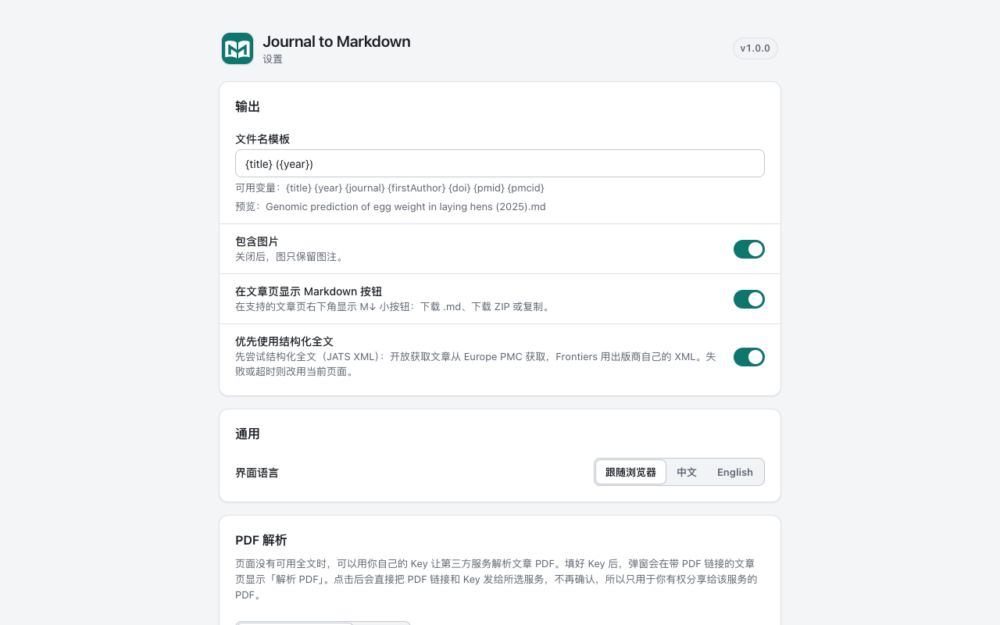

<div align="center">


# Journal to Markdown

**把正在阅读的期刊论文全文一键存为干净的 Markdown。**

[](https://github.com/Tendo33/journal-md/releases)
[](./LICENSE)
[](./src/manifest.json)

[安装](#安装) · [English](./README.en.md) · [权限说明](./docs/permissions.md) · [隐私说明](./PRIVACY.md) · [更新日志](./CHANGELOG.md)

</div>

> **「to Markdown」系列**：[arXiv to Markdown](https://github.com/Tendo33/arxiv-md) · [Zhihu to Markdown](https://github.com/Tendo33/zhihu-md) · **Journal to Markdown**。三款插件同一套界面和导出习惯，分别覆盖 arXiv 预印本、知乎和期刊全文。

在 PubMed Central、Nature、Frontiers 等期刊的文章页一键导出 Markdown，保留标题、作者、摘要、章节、公式（TeX）、表格、图注和参考文献脚注，适合放进 Obsidian、Zotero，或交给 AI 阅读。

## 功能

- **四个入口**：页面右下角的 **M↓ 悬浮按钮**（菜单：下载 .md、下载 ZIP、复制）、工具栏弹窗、右键菜单、快捷键 `Alt+Shift+J`（导出）。悬浮按钮可以用键盘操作、读屏可读，跟随系统深色模式，可在设置里或按钮菜单里隐藏。
- **输出**：YAML front matter（title、authors、journal、year、doi、pmid、pmcid、license、url、`source_route`、exported）；公式写成 `$…$` / `$$…$$`；没有合并单元格的表格写成 GFM 表格，有合并单元格的保留 HTML；正文引用变成 `[^n]` 脚注，参考文献带 DOI 链接；数据可用性、基金、利益冲突、致谢各自成节；补充材料列出文件名和链接。
- **下载 ZIP**：`article.md` + `images/`，正文里的图片链接改成包内路径。Springer / BMC / Nature 和 PLOS 的图片服务器（`media.springernature.com`、PLOS 的图片存储）不允许跨站下载，由后台下载。个别图片下载失败时照样生成 ZIP，这些图片保留网络链接并给出提示。
- **PDF 解析（可选）**：页面上没有可用全文时，可以用你自己的 Key 让 **PaddleOCR**（默认）或 **MinerU** 解析文章 PDF，结果下载为 ZIP。在设置里给所选服务填好 Key，弹窗里就会出现「用 … 解析 PDF」按钮；点击后直接发送 PDF 链接，不再确认。请只解析你有权分享给第三方的 PDF。Key 只存在本浏览器（`chrome.storage.local`）。
- **中英文界面**，跟随浏览器语言，也可在设置里切换。

## 支持的网站

| 网站 | 优先使用的结构化全文 | 兜底 |
| --- | --- | --- |
| PubMed Central（pmc.ncbi.nlm.nih.gov） | Europe PMC JATS（按 PMCID） | 当前页面 |
| Europe PMC（europepmc.org） | Europe PMC JATS（按 PMCID） | 当前页面（没有全文时只导出摘要，并标记 `abstract_only`） |
| PubMed（pubmed.ncbi.nlm.nih.gov） | 有 PMCID 且开放获取时取全文 | 题录 + 摘要 + MeSH，标记「仅摘要」 |
| Springer Link / BMC / SpringerOpen | Europe PMC JATS（按 DOI 查找，开放获取时） | 当前页面 |
| Nature / Scientific Reports | Europe PMC JATS（按 DOI） | 当前页面 |
| Frontiers | Frontiers 自己的 XML | Europe PMC JATS → 当前页面 |
| MDPI | Europe PMC JATS（按 DOI） | 当前页面 |
| PLOS | Europe PMC JATS（按 DOI） | 当前页面 |
| eLife | Europe PMC JATS（按 DOI） | 当前页面 |

只转换你本来就能看到的页面：不绕过付费墙，不批量抓取。订阅文章在你有权限时也能从当前页面导出。

## 安装

- **Chrome / Edge**：在 [Releases](https://github.com/Tendo33/journal-md/releases) 下载 `journal-md-v<版本>-chrome.zip`，解压后在 `chrome://extensions`（Edge 为 `edge://extensions`）打开开发者模式，「加载已解压的扩展程序」选择解压出来的文件夹。
- **Firefox**（140 及以上）：同一页面下载 `journal-md-v<版本>-firefox.zip`；正式签名版本上架 AMO 后再更新这里。
- 商店上架（Chrome Web Store、Edge 加载项）准备中。

## 使用

1. 打开支持网站上的一篇文章，例如 <https://pmc.ncbi.nlm.nih.gov/articles/PMC7095418/>。
2. 点页面右下角的 **M↓** 按钮选「下载 .md」，或点工具栏图标后选「导出 Markdown」。
3. 想把图片一起保存，选「下载 ZIP」；想直接粘贴，选「复制 Markdown」。

| 入口 | 说明 |
| --- | --- |
| 页面按钮 | 文章页右下角 M↓：下载 .md、下载 ZIP、复制；可在按钮菜单或设置里隐藏 |
| 工具栏弹窗 | 当前文章的平台、标题、DOI / PMCID / PMID 和全文来源；导出、复制、下载 ZIP；填好 Key 后有「解析 PDF」 |
| 快捷键 | 导出 `Alt+Shift+J`（macOS 为 `Option+Shift+J`）；复制默认不设，可在 `chrome://extensions/shortcuts` 指定 |
| 右键菜单 | 「导出本页为 Markdown」「复制本页为 Markdown」 |

## 设置



| 设置项 | 说明 | 默认 |
| --- | --- | --- |
| 文件名模板 | 可用 `{title}` `{year}` `{journal}` `{firstAuthor}` `{doi}` `{pmid}` `{pmcid}` | `{title} ({year})` |
| 包含图片 | 关闭后只保留图注 | 开启 |
| 在文章页显示 Markdown 按钮 | 右下角 M↓ 按钮 | 开启 |
| 优先使用结构化全文 | 先取 Europe PMC JATS（Frontiers 用自己的 XML），失败或超时用当前页面 | 开启 |
| 界面语言 | 跟随浏览器 / 中文 / English | 跟随浏览器 |
| PDF 解析 | 选择 PaddleOCR（默认）或 MinerU，填写并测试 Key；Key 只存在本浏览器 | PaddleOCR，未填 Key |
| 站点 | 逐个关闭不想导出的站点 | 全部开启 |

改动自动保存。

## 权限说明

所有权限都在安装时授予，使用中不会再弹出权限请求。逐项用途见 [docs/permissions.md](./docs/permissions.md)。

## 隐私

打开弹窗、加载页面时不发任何请求。导出时才会向 Europe PMC 请求开放获取全文（只发 PMCID 或 DOI，不带 Cookie 和页面地址）。PDF 解析只在你填了 Key 并点击解析时发生，只发给你选的那一个服务。所有权限都在安装时授予，使用中不会再弹出权限请求。详见 [PRIVACY.md](./PRIVACY.md)，权限说明见 [docs/permissions.md](./docs/permissions.md)。

## 已知限制

- Springer Link / Nature 页面上的表格只有表题和「完整表格」链接（表格内容在单独页面）；能从 Europe PMC 取到 JATS 时表格是完整的。
- PLOS 的 JATS 下载链接会跳转到没有跨域许可的存储域名，所以 PLOS 走 Europe PMC 或页面；MDPI 的 XML 下载有人机验证，同样不用。
- eLife 页面会把较长的图注折叠成「see more」，只从页面导出时图注可能不完整（走 Europe PMC 时完整）。
- PDF 解析把 PDF 链接交给第三方服务自己下载；需要登录或订阅才能下载的 PDF 通常会失败。

## 开发

需要 Node 22（见 `.nvmrc`）。

```bash
npm ci
npm run lint && npm test          # 单元测试只用 tests/fixtures，不访问网络
npm run build                     # Chrome / Edge → dist/
npm run build:firefox             # Firefox → dist-firefox/
npm run verify:dist               # 权限白名单、gecko id、locales、无 source map / Key
npm run package                   # build/*.zip
```

端到端冒烟见 `scripts/e2e-smoke.js`（Playwright 装在仓库外，经 `E2E_PLAYWRIGHT_DIR` 传入）。PDF 解析内核来自 arxiv-md，见 `vendor/pdf-parse-core/README.md`。

发布：推送 `v*` 标签后，GitHub Actions 的 Release 工作流构建、校验并创建 Release（见 `.github/workflows/release.yml`）。

## 同系列

| 插件 | 适用 | 获取 |
| --- | --- | --- |
| [arXiv to Markdown](https://github.com/Tendo33/arxiv-md) | arXiv 论文（摘要页、PDF、HTML） | [Chrome 应用商店](https://chromewebstore.google.com/detail/arxiv-to-markdown/pphdggfbjddgdljndgdablkhbdpbfnbd) |
| [Zhihu to Markdown](https://github.com/Tendo33/zhihu-md) | 知乎文章、回答、问题、信息流、热榜 | [Chrome 应用商店](https://chromewebstore.google.com/detail/zhihu-md/heeilejdelmogpbnbbhdokgfabmhkenh) |
| **Journal to Markdown** | PMC、PubMed、Springer、Nature、Frontiers、MDPI、PLOS、eLife | [Releases](https://github.com/Tendo33/journal-md/releases) |

## 更新日志

见 [CHANGELOG.md](./CHANGELOG.md)。

## License

[MIT](./LICENSE)
